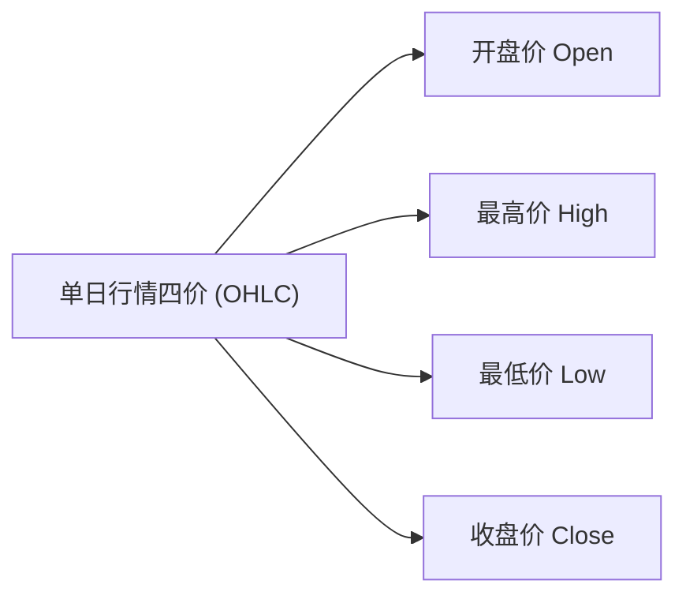
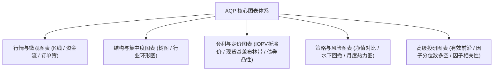
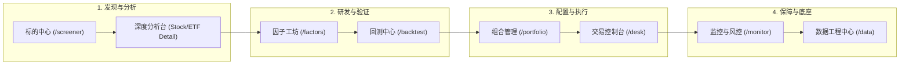

# 《从零到一精通量化投资：Alpha Quant Platform 终极知识科普、全图表解析与系统实操指南》

> **面向读者**：无金融工程背景的编程开发者、想转向理性规则交易的传统股民、初涉量化的量化爱好者与高校学生。  
> **核心特色**：拒绝空洞术语堆砌，用**生活比喻 + 数学直觉 + 15 大核心量化图表看盘指南 + 全平台 8 大工作台操作手册**，带你从容掌握专业量化系统的每一个界面与指标。

---

## 目录索引

- [第一篇：量化认知觉醒 —— 什么是量化投资？](#第一篇量化认知觉醒--什么是量化投资)
  - [1.1 两个投资者的故事：老张与小李](#11-两个投资者的故事老张与小李)
  - [1.2 生活中的量化类比：相亲评分与智能挑瓜](#12-生活中的量化类比相亲评分与智能挑瓜)
  - [1.3 量化的核心优势与局限性认知](#13-量化的核心优势与局限性认知)
- [第二篇：量化技术面与行情黑话大揭秘](#第二篇量化技术面与行情黑话大揭秘)
  - [2.1 K 线图与为什么必须“前复权”？](#21-k-线图与为什么必须前复权)
  - [2.2 均线系统 (MA)：趋势的“重力感应器”](#22-均线系统-ma趋势的重力感应器)
  - [2.3 经典技术指标：MACD、BOLL、RSI 与 ATR](#23-经典技术指标macdbollrsi-与-atr)
- [第三篇：量化的核心灵魂 —— 因子、Alpha 与多因子模型](#第三篇量化的核心灵魂--因子alpha-与多因子模型)
  - [3.1 什么是“因子 (Factor)”？股票的体检指标](#31-什么是因子-factor股票的体检指标)
  - [3.2 Alpha（真本事）vs Beta（大盘随波逐流）](#32-alpha真本事vs-beta大盘随波逐流)
  - [3.3 因子质量检验：IC、Rank IC 与 IR](#33-因子质量检验icrank-ic-与-ir)
  - [3.4 因子加工流水线：去极值、标准化、行业与市值中性化、正交化](#34-因子加工流水线去极值标准化行业与市值中性化正交化)
- [第四篇：策略与回测 —— 乘坐“时间机器”的科学法则](#第四篇策略与回测--乘坐时间机器的科学法则)
  - [4.1 什么是回测 (Backtest)？](#41-什么是回测-backtest)
  - [4.2 必须警惕的回测“三大致命陷阱”（严禁自欺欺人）](#42-必须警惕的回测三大致命陷阱严禁自欺欺人)
  - [4.3 经典量化策略模型：网格交易、趋势跟踪、均值回归与统计套利](#43-经典量化策略模型网格交易趋势跟踪均值回归与统计套利)
- [第五篇：怎样才算好策略？收益与风险的度量衡](#第五篇怎样才算好策略收益与风险的度量衡)
  - [5.1 收益维度：累计收益 vs 复合年化收益率 (CAGR)](#51-收益维度累计收益-vs-复合年化收益率-cagr)
  - [5.2 风险维度：年化波动率、最大回撤 (Max DD) 与在险价值 (VaR)](#52-风险维度年化波动率最大回撤-max-dd-与在险价值-var)
  - [5.3 性价比维度：夏普比率 (Sharpe)、索提诺比率 (Sortino) 与卡玛比率 (Calmar)](#53-性价比维度夏普比率-sharpe索提诺比率-sortino-与卡玛比率-calmar)
- [第六篇：多资产与微观结构 —— ETF、债券与衍生品玩法](#第六篇多资产与微观结构--etf债券与衍生品玩法)
  - [6.1 ETF 深度透视：一二级市场申赎、IOPV 实时折溢价套利与 T+0](#61-etf-深度透视一二级市场申赎iopv-实时折溢价套利与-t0)
  - [6.2 债券固定收益：修正久期与二阶凸性仿真](#62-债券固定收益修正久期与二阶凸性仿真)
  - [6.3 跨市场套利：AH 股溢价与港股通联动](#63-跨市场套利ah-股溢价与港股通联动)
  - [6.4 期货与大宗商品：基差、展期升贴水与对冲](#64-期货与大宗商品基差展期升贴水与对冲)
- [【核心专章】第七篇：平台 15 大专业量化图表百科与看盘读图指南](#第七篇平台-15-大专业量化图表百科与看盘读图指南)
  - [7.1 专业 K 线图与复合附图指标 (K-Line & Overlay)](#71-专业-k-线图与复合附图指标-k-line--overlay)
  - [7.2 资金流向四档柱状图 (Money Flow Chart)](#72-资金流向四档柱状图-money-flow-chart)
  - [7.3 资产持仓矩形树图 (Holdings Treemap)](#73-资产持仓矩形树图-holdings-treemap)
  - [7.4 行业配置甜甜圈/饼图 (Industry Donut Chart)](#74-行业配置甜甜圈饼图-industry-donut-chart)
  - [7.5 回撤水下曲线图 (Underwater Drawdown Chart)](#75-回撤水下曲线图-underwater-drawdown-chart)
  - [7.6 区间归一化累计收益对比图 (Cumulative Return Chart)](#76-区间归一化累计收益对比图-cumulative-return-chart)
  - [7.7 跟踪误差时序图与基准拟合走势 (Tracking Error & Benchmark Chart)](#77-跟踪误差时序图与基准拟合走势-tracking-error--benchmark-chart)
  - [7.8 ETF 实时参考净值 (IOPV) 与套利带宽图 (IOPV Arbitrage Bandwidth)](#78-etf-实时参考净值-iopv-与套利带宽图-iopv-arbitrage-bandwidth)
  - [7.9 债券基准久期与利率二阶凸性阶梯仿真曲线 (Bond Convexity Simulation)](#79-债券基准久期与利率二阶凸性阶梯仿真曲线-bond-convexity-simulation)
  - [7.10 商品黄金现货基差布林带通道 (Basis Bollinger Bands)](#710-商品黄金现货基差布林带通道-basis-bollinger-bands)
  - [7.11 因子分位数多空分组收益柱线图 (Quantile Spreads Returns)](#711-因子分位数多空分组收益柱线图-quantile-spreads-returns)
  - [7.12 因子相关性热力矩阵 (Factor Correlation Heatmap)](#712-因子相关性热力矩阵-factor-correlation-heatmap)
  - [7.13 策略收益月度/年度日历热力图 (Monthly & Yearly Heatmap)](#713-策略收益月度年度日历热力图-monthly--yearly-heatmap)
  - [7.14 马科维茨投资组合有效前沿曲线 (Markowitz Efficient Frontier)](#714-马科维茨投资组合有效前沿曲线-markowitz-efficient-frontier)
  - [7.15 深度订单簿与盘口量能梯 (Order Book DOM & Market Depth)](#715-深度订单簿与盘口量能梯-order-book-dom--market-depth)
- [【核心专章】第八篇：Alpha Quant Platform (AQP) 8 大功能工作台全景深度指南](#第八篇alpha-quant-platform-aqp-8-大功能工作台全景深度指南)
  - [8.1 标的中心 (Instruments Hub)：选股、ETF 与期货全市场雷达](#81-标的中心-instruments-hub选股etf-与期货全市场雷达)
  - [8.2 单标的深度分析台 (Stock & ETF Details)：极速回测与专属看板](#82-单标的深度分析台-stock--etf-details极速回测与专属看板)
  - [8.3 因子工坊 (Factor Studio)：因子的量化炼丹炉](#83-因子工坊-factor-studio因子的量化炼丹炉)
  - [8.4 回测中心 (Backtest Hub)：工业级策略检验与走步优化](#84-回测中心-backtest-hub工业级策略检验与走步优化)
  - [8.5 组合管理 (Portfolio)：有效前沿与风险平价](#85-组合管理-portfolio有效前沿与风险平价)
  - [8.6 交易控制台 (Order Desk)：模拟纸交易与算法拆单](#86-交易控制台-order-desk模拟纸交易与算法拆单)
  - [8.7 监控与风控 (Monitor & Risk Control)：投资的安全气囊](#87-监控与风控-monitor--risk-control投资的安全气囊)
  - [8.8 数据工程中心 (Data Center)：系统底座与多源容灾](#88-数据工程中心-data-center系统底座与多源容灾)
- [第九篇：附录 —— 量化高频名词极速字典与常见误区 Q&A](#第九篇附录--量化高频名词极速字典与常见误区-qa)

---

## 第一篇：量化认知觉醒 —— 什么是量化投资？

### 1.1 两个投资者的故事：老张与小李

```mermaid
flowchart TD
    subgraph 传统主观投资者 (老张)
        Z1["刷短视频 / 股吧论坛看大V推荐"] --> Z2["凭感觉：'这票今天肯定涨！'"]
        Z2 --> Z3["重仓杀入 (单吊一只票)"]
        Z3 --> Z4{"市场真实走势"}
        Z4 -- 涨了 3% --> Z5["担心利润缩水，赶紧卖掉 (拿不住)"]
        Z4 -- 跌了 15% --> Z6["舍不得割肉，死扛变股东 (越亏越多)"]
    end

    subgraph 现代量化投资者 (小李)
        L1["搜集全市场 5000+ 标的历史数据"] --> L2["数学建模与因子统计挖掘 (ROE/PE/动量)"]
        L2 --> L3["计算机严格回测（扣除佣金、滑点与印花税）"]
        L3 --> L4["程序化条件单 / 算法自动挂单分批买入"]
        L4 --> L5["严格执行止盈止损与仓位分散，无情绪干扰"]
    end
```

* **主观投资者（老张）**：
  老张投资的核心逻辑是“**直觉与故事**”。老张每天花大量时间看大V讲故事，听内幕消息。赚钱了以为自己是股神，亏钱了怪庄家操盘。人性的贪婪（追高）与恐惧（割肉）被市场反复收割。
* **量化投资者（小李）**：
  小李投资的核心逻辑是“**概率与纪律**”。小李将投资决策完全转化为**数学规则**：“全市场寻找 ROE > 15%、PE 处于历史前 20% 分位且过去 20 天动量最强的股票；每只股票分配 5% 仓位；当单票浮亏达 7% 时计算机自动平仓”。电脑负责盯盘，毫无情绪波动。

---

### 1.2 生活中的量化类比：相亲评分与智能挑瓜

如果你觉得量化听起来高深莫测，其实你在日常生活中早已用过量化思维：

> [!NOTE] **相亲评分卡（多因子模型类比）**
> * **主观相亲**：第一眼看去“顺眼不顺眼”、“有没有感觉”，全凭感性。
> * **量化相亲**：制定一张评分表：
>   * 年龄因子（权重 20%）
>   * 学历因子（权重 20%）
>   * 年收入因子（权重 30%）
>   * 脾气性格测验分（权重 30%）  
>   最后计算综合加权得分：$\text{Score} = \sum w_i \times x_i$。得分大于 80 分的进入下一轮候选池。这就是量化中最基础也是最重要的**多因子加权打分选股模型**！

> [!TIP] **科学挑西瓜（指标与特征提取）**
> * 传统挑瓜：拍拍西瓜听声音（经验直觉）。
> * 量化挑瓜：携带测量仪器，测试瓜皮硬度、纹路密度、糖度折射率、瓜蒂新鲜度。通过对 1000 个西瓜的历史数据统计，发现“糖度 > 12 且瓜蒂卷曲”的西瓜甜的概率是 92%。这就找到了一个**高胜率有效因子**。

---

### 1.3 量化的核心优势与局限性认知

* **三大核心优势**：
  1. **覆盖维度极广**：人类大脑每天只能细看 10~20 只股票，计算机可以在 1 秒内完成全市场 5000 只股票、上千只 ETF 及全品种期货的特征扫描。
  2. **克服人性弱点**：程序没有贪婪、恐惧与侥幸心理，止损坚定，避免“一亏到底”。
  3. **可证伪与可迭代**：任何交易想法都必须在历史历史数据中经过严格测试，能跑通才上线，无法跑通直接推翻，杜绝迷信玄学。
* **正确认知局限性**：
  * **量化不是“提款机”或“稳赚不赔的巫术”**：量化交易追求的是统计学上的**正期望值（Edge）**，例如 55% 的胜率与 1.5 的盈亏比，通过大数定律在成百上千次交易中累积确定性复利。
  * **黑天鹅与过拟合风险**：市场是动态博弈的复杂自适应系统，过去的规律在未来可能突变（阿尔法衰减）。

---

## 第二篇：量化技术面与行情黑话大揭秘

### 2.1 K 线图与为什么必须“前复权”？



#### ① K 线的形态解构
每根蜡烛（K线）记录了一定周期内的四个关键价格：
* **实体部分**：开盘价 (Open) 与 收盘价 (Close) 之间的矩形区域。
  * **红柱（阳线）**：$Close > Open$（收盘高于开盘，今天涨了）；
  * **绿柱（阴线）**：$Close < Open$（收盘低于开盘，今天跌了）。
* **影线部分**：
  * 细线向上刺出的顶点是 **最高价 (High)**；
  * 细线向下刺出的底点是 **最低价 (Low)**。

#### ② 什么是“除权除息”与“复权处理”？
上市公司送股或分红时，股价会人为下调：
* **除权实例**：某股票原本 100 元，公司决定“10 送 10”（股民手里的 1 股变成 2 股）。第二天股价会自动调整为 50 元。
* **如果不复权**：图表上会出现一个断崖式的暴跌跳空缺口（从 100 跌到 50，视觉上暴跌了 50%）。如果量化均线直接计算，就会误判为发生灾难性抛售而错误止损！
* **复权方法对比**：
  * **前复权 (QFQ, Forward Adjusted)**：以当前最新价格为基准，将历史所有的分红送股缺口向下拉平，保证**现在的价格就是真实价格，历史走势连续平滑**。**量化策略研究与指标计算 100% 推荐使用前复权！**
  * **后复权 (HFQ, Backward Adjusted)**：以股票上市首日价格为基准，计算如果从上市拿红利再投至今的原始累计净值。

---

### 2.2 均线系统 (MA)：趋势的“重力感应器”

**移动平均线 (Moving Average, MA)** 是最古老也是生命力最强的趋势跟踪工具：
$$\text{SMA}_N = \frac{P_t + P_{t-1} + \dots + P_{t-N+1}}{N}$$

* **常见周期含义**：
  * **5日均线 (MA5)**：过去 1 周资金平均持仓成本，反映极短期热钱情绪；
  * **20日均线 (MA20)**：月线生命线，中线波段的依托；
  * **60日均线 (MA60)**：季度均线，中期趋势方向；
  * **250日均线 (MA250)**：年线，牛熊分界线。股价站上年线代表长期多头，跌破年线代表弱势震荡。
* **均线量化形态**：
  * **金叉 (Golden Cross)**：短期均线（如 MA5）自下而上穿破长期均线（如 MA20），通常代表短期动能爆发，构成买入信号。
  * **死叉 (Death Cross)**：短期均线自上而下穿破长期均线，代表短期资金出逃，构成卖出/止损信号。

---

### 2.3 经典技术指标：MACD、BOLL、RSI 与 ATR

| 指标名称 | 全称与构成 | 核心金融逻辑与使用诀窍 |
| :--- | :--- | :--- |
| **MACD** | 指数平滑异同移动平均线<br>（DIF 快线、DEA 慢线、MACD 柱） | 通过 EMA12 与 EMA26 的差值平滑，消除短期毛刺。<br>• **水上金叉**：在零轴上方金叉，强势多头主升浪；<br>• **顶背离**：股价创出新高，但 MACD 红柱或 DIF 峰值反而降低，代表多头动能衰竭，警惕大跌。 |
| **BOLL** | 布林带通道 (Bollinger Bands)<br>（中轨 MA20，上下轨 $\pm 2\sigma$） | 根据统计正态分布，价格有约 **95.4%** 的概率运行在 $2\sigma$ 带宽内。<br>• **带宽收窄 (Squeeze)**：波动率剧烈降低，预示着大级别单边突破在即；<br>• **均值回归**：在震荡市中，触碰下轨超卖反弹买入，触碰上轨超买止盈。 |
| **RSI** | 相对强弱指标 (Relative Strength Index)<br>（取值 0 ~ 100） | 衡量过去 $N$ 天内上涨点数与下跌点数的相对力量比例。<br>• $\text{RSI} > 80$：严重超买，随时可能见顶回调；<br>• $\text{RSI} < 20$：严重超卖，随时可能发生空头回补反弹。 |
| **ATR** | 真实波幅 (Average True Range) | 综合考虑当日振幅与跳空缺口后的绝对价格波动幅度。<br>**量化头寸管理神器**：波动大的股票仓位买少一点，波动小的买多一点（基于 ATR 的风险平价仓位管理）。 |

---

## 第三篇：量化的核心灵魂 —— 因子、Alpha 与多因子模型

### 3.1 什么是“因子 (Factor)”？股票的体检指标

在量化金融里，**“因子”就是能够用来解释或预测资产预期收益率与风险特征的变量**。就像医生给病人做体检，通过“血压、血糖、心率、白细胞”判断一个人的健康状况；量化研究员通过对 5000 只股票计算几十上百个因子，挑出最优秀的投资标的。

* **价值因子 (Value)**：市盈率 (PE)、市净率 (PB)、股息率 (Dividend Yield)。
* **成长因子 (Growth)**：营收同比增速、归母净利润同比增速。
* **质量因子 (Quality)**：净资产收益率 (ROE)、资产负债率、毛利率。
* **动量因子 (Momentum)**：近 20 日涨跌幅、创半年新高天数。
* **微观资金流因子 (Flow)**：主力大单净买入额、超大单买入占比。

---

### 3.2 Alpha（真本事）vs Beta（大盘随波逐流）

在现代金融学著名的资本资产定价模型 (CAPM) 中：
$$R_i = R_f + \beta_i \times (R_m - R_f) + \alpha_i$$

* **Beta ($\beta$, 贝塔收益)**：你的投资组合随大盘涨跌的弹性系数。大盘涨 10%，你的策略跟着涨 10%，这是大势红利，不体现高超技术。
* **Alpha ($\alpha$, 阿尔法收益)**：剔除大盘涨跌影响后，纯粹依靠你的选股模型与风控纪律赚取到的超额收益。大盘跌了 5%，你的策略通过多空对冲净赚 8%，这 8% 就是纯粹的 Alpha！

---

### 3.3 因子质量检验：IC、Rank IC 与 IR

一个因子到底灵不灵，不是凭感觉，而是看统计数据：

1. **Rank IC (秩信息系数)**：
   将因子值按大小排序（排名 1 到 5000）与股票下一期的收益率排名计算斯皮尔曼秩相关系数。
   * **Rank IC 均值 > 0.03**：属于及格可用因子；
   * **Rank IC 均值 > 0.05**：属于非常优秀的强预测因子。
2. **IR (Information Ratio, 因子信息比率)**：
   $$\text{IR} = \frac{\text{Mean}(\text{IC})}{\text{Std}(\text{IC})}$$
   衡量因子选股预测能力的稳定性。持续稳定正相关的因子 IR 才会高（一般 $\text{IR} > 0.5$ 视为稳健）。

---

### 3.4 因子加工流水线：去极值、标准化、行业与市值中性化、正交化

原始数据就像未经打磨的矿石，直接塞给模型会导致严重的模型失真。必须经过四步“量化精炼流水线”：


#### ① 去极值 (Winsorization)
金融数据中经常有极端离群值（比如某只亏损退市边缘的公司市盈率高达 10000 倍）。如果不处理，均值会被瞬间拉偏。
* **MAD 法 (Median Absolute Deviation)**：
  找出序列的中位数 $\text{Median}$ 以及中位数绝对偏差 $\text{MAD} = \text{Median}(|x_i - \text{Median}|)$。将超出 $[\text{Median} - 3 \times 1.4826 \times \text{MAD}, \text{Median} + 3 \times 1.4826 \times \text{MAD}]$ 范围的异常值强行拉回边界截断。

#### ② 标准化 (Z-Score Normalization)
让每个因子的数值尺度统一：
$$z_i = \frac{x_i - \mu}{\sigma}$$
处理后所有因子均值为 0，标准差为 1，可以在同一个尺度上加权组合。

#### ③ 行业与市值中性化 (Neutralization)
> [!WARNING] **小市值陷阱！**
> 很多新手算出一个动量因子表现极好，回测收益爆炸。但实盘上线后发现：在牛市里赚很多，震荡市回撤惨烈。
> 深入归因才发现：**他根本没有选出什么超额公司，他挑选出来的全都是市值 20 亿以下的小盘妖股！** 他只是在下注“小市值风格暴露”。
* **中性化做法**：通过线性多元回归（OLS），将因子值对“申万一级行业哑变量”和“对数流通市值”做回归，**只取回归的残差项 (Residual) 作为最终因子值**。
  $$F_i = \sum \beta_{\text{ind}} \times \text{Ind}_i + \beta_{\text{size}} \times \ln(\text{Size}_i) + \epsilon_i$$
  残差 $\epsilon_i$ 就代表“在剔除了属于什么行业、剔除了盘子大小之后，这家公司独特的净 Alpha 价值”！

#### ④ 因子正交化 (Orthogonalization)
两个因子如果高度雷同（比如 ROE 与 ROA 相关系数达 0.85），直接加权就相当于把同一个因子加了两次权重。通过施密特正交化 (Gram-Schmidt) 或对称正交化，将因子空间旋转成互相垂直（协方差为 0）的无关基向量。

---

## 第四篇：策略与回测 —— 乘坐“时间机器”的科学法则

### 4.1 什么是回测 (Backtest)？

回测是在计算机中，让虚拟账户穿越回 3 年、5 年前，从历史第一天开始，按天（或按分钟）模拟执行策略逻辑，真实扣减手续费与滑点，最终统计出策略的历史净值曲线。

---

### 4.2 必须警惕的回测“三大致命陷阱”（严禁自欺欺人）

如果回测不讲武德，造出年化收益 1000% 的神仙策略只需几行代码，但在真实实盘中会迅速爆仓：

1. **未来函数 (Look-ahead Bias / Peeking)**：
   * **现象**：在今天 9:30 开盘做决策时，代码里偷偷用到了当天 15:00 的收盘价，或在 3 月 31 日提前用到了 4 月底才公布的年报数据。
   * **危害**：相当于考试前偷看了答案，回测胜率 100%，实盘立刻亏损。
2. **幸存者偏差 (Survivorship Bias)**：
   * **现象**：回测股票池只取了**今天依然上市在交易的股票**。过去 5 年里退市甚至爆雷摘牌的股票被完全剔除。
   * **危害**：相当于只统计从战场回来的老兵，误以为战场很安全。
3. **过度拟合 (Overfitting / Data Snooping)**：
   * **现象**：在历史数据里狂加 20 个严苛过滤参数，把历史拟合得天衣无缝。
   * **危害**：策略只是把历史上的随机噪声死记硬背下来了。未来一旦行情稍有变化，策略表现断崖式暴跌。

---

## 第五篇：怎样才算好策略？收益与风险的度量衡

| 指标 | 计算公式 | 经典解释与实战意义 | 优秀阈值 |
| :--- | :--- | :--- | :--- |
| **复合年化收益率 (CAGR)** | $(P_{\text{end}} / P_{\text{start}})^{252/N} - 1$ | 消除周期长短影响，衡量年均复合滚雪球速度。 | $> 15\%$ |
| **年化波动率 ($\sigma_{\text{ann}}$)** | $\text{Std}(r_t) \times \sqrt{252}$ | 收益的跳跃离散程度。波动率越高，账户上蹿下跳越厉害。 | $< 20\%$ |
| **最大回撤 (Max DD)** | $\max_t (1 - P_t / \max_{\tau \le t} P_\tau)$ | **最倒霉时刻**：历史最高点买入一直跌到底部的最大亏损幅度。衡量投资者的心理承受极限。 | $\ge -15\%$ |
| **夏普比率 (Sharpe)** | $\frac{R_p - R_f}{\sigma_{\text{ann}}}$ | **每承受 1 份总波动，换取多少超额收益**。<br>缺点：把“连续涨停”产生的大波动也当成了风险。 | $> 1.0$ 合格<br>$> 2.0$ 极佳 |
| **索提诺比率 (Sortino)** | $\frac{R_p - R_f}{\sigma_{\text{down}}}$ | **夏普的改良版**。计算分母时**剔除所有赚钱的日期，只对产生实质亏损的负收益日计算下行波动率 ($\sigma_{\text{down}}$)**。更符合散户真实体感！ | $> 1.5$ 优秀 |
| **卡玛比率 (Calmar)** | $\frac{R_p - R_f}{\|\text{Max DD}\|}$ | **收益与回撤的终极比值**。衡量“从坑里爬出来的赚钱效率”。如果年化收益 20%，最大回撤只有 10%，Calmar 高达 2.0！ | $> 1.5$ 极佳 |

---

## 第六篇：多资产与微观结构 —— ETF、债券与衍生品玩法

### 6.1 ETF 深度透视：一二级市场申赎、IOPV 实时折溢价套利与 T+0

* **IOPV (实时参考净值)**：交易所每 15 秒根据 ETF 持有的一篮子股票的实时最新股价，加权算出来的**真实内涵每份价值**。
* **折价与溢价**：
  * **溢价率 > 0**：二级市场现价高于 IOPV（大家在疯狂抢购，买贵了）；
  * **折价率 < 0**：二级市场现价低于 IOPV（场内砸盘，比实际持仓还便宜）。
* **ETF 的核心优势**：
  1. **免印花税**：A 股股票卖出必须缴纳 0.05% 的印花税，而 **ETF 交易 100% 免印花税**！每年高频调仓能省下巨额磨损。
  2. **T+0 制度**：跨境 QDII ETF（如纳指ETF）、债券 ETF、黄金商品 ETF、货币 ETF 支持**当天买入当天卖出（T+0 灵活回转交易）**。

### 6.2 债券固定收益：修正久期与二阶凸性仿真

* **修正久期 (Modified Duration, $D_{\text{mod}}$)**：衡量利率变动 1% 时，债券价格的线性涨跌百分比。
* **二阶凸性 (Convexity, $C$)**：二阶增益公式：
  $$\frac{\Delta P}{P} \approx - D_{\text{mod}} \cdot \Delta y + \frac{1}{2} C \cdot (\Delta y)^2$$
  无论是利率上涨还是利率下跌，$(\Delta y)^2 \ge 0$ 恒为正数！这意味着具有大凸性 $C$ 的债券在利率下跌时涨得比久期预测的多，在利率上升时跌得比久期预测的少！

---

## 第七篇：平台 15 大专业量化图表百科与看盘读图指南

在 Alpha Quant Platform 中，图表不是简单的装饰，而是**量化交易员洞察市场异动、评估模型质量与寻找套利机会的雷达**。以下是全系统 15 类核心图表的深度读图指南：



---

### 7.1 专业 K 线图与复合附图指标 (K-Line & Overlay)
* **对应组件与页面**：[`KLineChart`](file:///D:/Python_Project/Alpha%20Quant%20Platform/frontend/src/components/charts/KLineChart.tsx) 出现在 [个股分析](file:///D:/Python_Project/Alpha%20Quant%20Platform/frontend/src/pages/StockDetail/index.tsx) 与 [ETF 分析](file:///D:/Python_Project/Alpha%20Quant%20Platform/frontend/src/pages/EtfDetail/index.tsx)。
* **形态构成**：主图为前复权日蜡烛图，叠加 MA5/20/60/250 均线；副图支持成交量柱状图与 MACD/BOLL/RSI 等指标。
* **量化作用**：消除除权除息造成的跳空伪信号，直观观察标的所处的牛熊生命周期与均线缠绕形态。
* **看图诀窍**：
  * **均线多头排列**：MA5 > MA20 > MA60，K 线稳步站在均线上方，适合动量策略顺势做多；
  * **布林带喇叭口收窄 (BOLL Squeeze)**：上下轨距离急剧缩窄，预示着震荡即将结束，暴风雨级别单边突破即将来临。

---

### 7.2 资金流向四档柱状图 (Money Flow Chart)
* **对应位置**：个股与 ETF 详情页中的「资金流向」卡片。
* **形态构成**：横轴为最近 20 个交易日，纵轴为每日净买入金额（万元或亿元）。将资金拆分为**超大单（机构大资金）、大单、中单、小单（散户散钱）**。
* **量化作用**：识破“主力暗中建仓或悄悄出货”。传统股价可能会被少量资金拉抬，但资金流向直接记录逐笔成交成交单的真实手笔。
* **看图诀窍**：
  * **散户接盘陷阱**：股价微涨，但超大单与大单持续大幅净流出（绿柱深陷），小单疯狂净流入，说明主力正在趁高派发筹码；
  * **主力隐蔽建仓**：股价缩量横盘震荡，但超大单连续多日呈现红色净买入，预示蓄势待发。

---

### 7.3 资产持仓矩形树图 (Holdings Treemap)
* **对应位置**：ETF 分析与投资组合页中的「持仓明细 $\to$ 树图模式」。
* **形态构成**：矩形色块填满整个卡片。**色块面积大小严格正比于该股票在 ETF 中的持仓市值权重**；色块颜色深浅代表该股票当天的涨跌幅（红涨绿跌）。
* **量化作用**：一秒看透“抱团股主导地位”。有些 ETF 虽然宣称持有上百只股票，但通过树图能一眼看出前 3 大重仓股是否独占了超过 50% 的面积。
* **看图诀窍**：面积最大的几个核心色块直接决定了该 ETF 当日的净值走势（擒贼先擒王）。

---

### 7.4 行业配置甜甜圈/饼图 (Industry Donut Chart)
* **对应位置**：ETF 详情页中的「行业配置」卡片。
* **形态构成**：环形甜甜圈图，分块标注申万一级行业（如电子、医药生物、电力设备、银行）的百分比占比。
* **量化作用**：透视风格敞口（Style Exposure）。很多投资者以为自己买了多元化基金，看了甜甜圈图才发现 70% 的仓位全在半导体。
* **看图诀窍**：配合右侧的「行业集中度」卡片，若前两大行业合计超过 60%，该标的属于行业主题型强周期 ETF；若行业分布均匀，则属于稳健宽基。

---

### 7.5 回撤水下曲线图 (Underwater Drawdown Chart)
* **对应位置**：回测中心大盘、ETF 风险度量卡、投资组合净值报告。
* **形态构成**：
  ```text
  0% ------------------------ (历史最高净值基准水平面)
       \                  /
        \      /\        /
         \    /  \      /  <- 资产潜入水下深处 (正在被套中)
          \  /    \    /
  -15% ----\/------\--/--- (最大下潜深度 = 最大回撤 Max Drawdown)
  ```
  横轴为时间，**纵轴顶端牢牢钉在 0%**，整条曲线永远在 0% 以下游弋。
* **量化作用**：
  传统净值走势图容易让人产生“长期一直在涨”的乐观错觉。水下回撤图逼迫交易员直视**痛苦的真相**：历史上每次亏损跌了多深、在水下痛苦煎熬了多少个月才浮出水面。
* **看图诀窍**：
  * **下潜深度**：曲线最低点探底多深（如 -25%）；
  * **水下时长**：一次跌落后横盘多久才重新爬回 0% 轴。优秀策略应该“浅下潜、快爬坑”。

---

### 7.6 区间归一化累计收益对比图 (Cumulative Return Chart)
* **对应位置**：ETF 详情页「区间表现」卡、极速回测抽屉。
* **形态构成**：将所选观察区间（如过去 1 年、60 天）的首日价格强制归一化为 **0%**，曲线走势直接表示“从起点至今累计净赚了多少百分比”。
* **量化作用**：消除绝对价格影响。一只 3.00 元的 ETF 和一只 100 元的股票无法直接在价格轴上比高低，归一化后可以在同一基准线上直观对比收益弹性。

---

### 7.7 跟踪误差时序图与基准拟合走势 (Tracking Error & Benchmark Chart)
* **对应位置**：ETF 详情页「跟踪误差分析」与「跟踪与基准分析」卡片。
* **形态构成**：
  * **主图**：ETF 累计收益曲线（亮蓝线）与标的基准指数曲线（灰色虚线）叠合同行；
  * **差值柱状图**：下方每日日收益差 $\epsilon_t = r_{\text{etf}} - r_{\text{index}}$。
* **量化作用**：检验基金经理是否“偷懒”或“跑偏”。合格的被动指数 ETF 应该像影子一样紧贴基准虚线。
* **看图诀窍**：如果两线出现持续扩大的张嘴背离，或者柱状图剧烈上下翻飞，说明该 ETF 存在严重的现金拖累、打新收益干扰或高额管理费磨损。

---

### 7.8 ETF 实时参考净值 (IOPV) 与套利带宽图 (IOPV Arbitrage Bandwidth)
* **对应位置**：股票型 ETF 详情页中的「股票 ETF 专属量化看板」。
* **形态构成**：横轴为交易时间（9:30 ~ 15:00），白线为场内实时最新成交价，橙色虚线为每 15 秒计算的 IOPV 参考净值；背景淡淡渲染出 $\pm 0.3\%$ 的绿红套利带宽区域。
* **量化作用**：捕捉一二级市场日内统计套利无风险机会。
* **实战套利信号**：
  * **正溢价套利窗口**：白线向上突破 $+0.3\%$ 橙线上轨，此时场内散户情绪亢奋买贵了，量化机构可在场外一键申购一篮子股票换成 ETF，在场内以溢价卖出锁定无风险收益；
  * **折价套利窗口**：白线跌破 $-0.3\%$ 下轨，场内恐慌砸盘，量化机构场内低价买入份额并在场外申请赎回换回一篮子股票卖出。

---

### 7.9 债券基准久期与利率二阶凸性阶梯仿真曲线 (Bond Convexity Simulation)
* **对应位置**：债券型 ETF（如 511090 30年国债ETF）专属量化看板。
* **形态构成**：
  * 横轴为基准市场利率变化幅度（从 $-100\text{bp}$ 到 $+100\text{bp}$）；
  * 灰色直线：一阶修正久期线性预测线（单纯的反比例直线）；
  * **橙色加粗曲线**：引入二阶凸性 $\frac{1}{2} C (\Delta y)^2$ 后的真实非线性价格预测线。
* **量化作用**：可视化债券的“涨多跌少”正凸性护城河。
* **看图诀窍**：观察利率下行 100bp 时，橙色曲线明显翘向更高收益（比直线多赚一块凸性增益）；利率上升 100bp 时，橙色曲线跌幅明显收窄（凸性缓冲了下跌）。

---

### 7.10 商品黄金现货基差布林带通道 (Basis Bollinger Bands)
* **对应位置**：商品型 ETF（如 518880 黄金ETF）专属量化看板。
* **形态构成**：折线记录近 60 个交易日黄金 ETF 相比上海黄金交易所 Au9999 实物金现货的基差（元/克），并画出基差的均值线与 $\pm 2\sigma$ 布林通道。
* **量化作用**：监控大宗商品二级市场与实体实物交割价之间的定价偏差，防止散户在现货平稳时盲目追高场内溢价。
* **看图诀窍**：当基差触及布林带上轨极值时，切忌追高，大概率会向现货基准回归回调。

---

### 7.11 因子分位数多空分组收益柱线图 (Quantile Spreads Returns)
* **对应位置**：[因子工坊 (Factor Studio)](file:///D:/Python_Project/Alpha%20Quant%20Platform/frontend/src/pages/FactorStudio/index.tsx) 中的「分位数收益差」卡片。
* **形态构成**：
  * 将全市场股票按某因子得分高低排序，均匀分成 5 组（Q1 到 Q5）；
  * 图中画出 5 条不同颜色的累计收益曲线，以及柱状图展示 Q1 相比 Q5 的多空净对冲收益。
* **量化作用**：**这是量化对冲基金检验因子选股能力最权威的“照妖镜”！**
* **看图诀窍**：
  * **完美的单调性**：曲线必须呈现教科书级的“彩虹发散”——Q1 组收益最高在最上方，Q2、Q3、Q4 依次向下，Q5 组收益最低在最下方；
  * **无效因子**：5 条线纠缠在一起，或者 Q3 跑得比 Q1 还要高，说明该因子没有稳定的选股能力。

---

### 7.12 因子相关性热力矩阵 (Factor Correlation Heatmap)
* **对应位置**：因子工坊中的「因子相关性实验室」。
* **形态构成**：$N \times N$ 的方格矩阵。横纵坐标为各个候选因子；方格颜色从深蓝（相关系数 -1.0）经白色（0.0）到深红（+1.0）。
* **量化作用**：诊断因子冗余与共线性。
* **看图诀窍**：如果发现两个因子（如 ROE 和 净利率）交叉的方格呈现鲜艳的深红色（相关系数 > 0.8），说明信息严重重复，必须通过施密特正交化剔除冗余。

---

### 7.13 策略收益月度/年度日历热力图 (Monthly & Yearly Heatmap)
* **对应位置**：回测中心大盘的「月度收益热力矩阵」。
* **形态构成**：表格日历形状。纵轴为年份（如 2021 ~ 2026），横轴为 1 ~ 12 月份，每个格子填入该月的净收益百分比，颜色深浅与收益正负对应（红涨绿跌）。
* **量化作用**：识别策略的“气候适应性与季节性偏好”。
* **看图诀窍**：一个年化收益 30% 的策略，如果看热力图发现收益全部来自于某一个月的异常暴赚，其余 11 个月全是连跌绿格，说明策略缺乏普适性，实战容错率极低。

---

### 7.14 马科维茨投资组合有效前沿曲线 (Markowitz Efficient Frontier)
* **对应位置**：[投资组合页面 (Portfolio)](file:///D:/Python_Project/Alpha%20Quant%20Platform/frontend/src/pages/Portfolio/index.tsx) 中的有效前沿卡片。
* **形态构成**：
  ```text
  预期收益率 E(R)
      ^            /---------------- 有效前沿 (Optimal Frontier)
      |          /   * 最大夏普切线点 (Tangency Portfolio)
      |         /
      |        * 全局最小方差组合 (GMV)
      |         \
      |          \---------------- 低效组合区域 (相同风险下收益低)
      +---------------------------------> 波动率 / 风险 (Sigma)
  ```
  横轴为预期年化波动率（风险），纵轴为预期年化收益率。散点为候选股票，上方平滑的外凸边缘即为**有效前沿**。
* **量化作用**：打破单一股票局限，指导资产配置。在给定风险预算下寻找收益最高的资产配比，或在给定预期收益下寻找风险最小的配比。
* **看图诀窍**：系统计算出的“最大夏普比率切线点”是全场性价比最高的黄金资产配比！

---

### 7.15 深度订单簿与盘口量能梯 (Order Book DOM & Market Depth)
* **对应位置**：[交易控制台 (Order Desk)](file:///D:/Python_Project/Alpha%20Quant%20Platform/frontend/src/pages/OrderDesk/index.tsx) 中的盘口撮合模块。
* **形态构成**：
  * 左侧绿色阶梯：买一至买十档位的价格与挂单手数累积（买盘深度 Bid）；
  * 右侧红色阶梯：卖一至卖十档位的价格与挂单手数累积（卖盘深度 Ask）。
* **量化作用**：判断日内即时买卖压力与支撑阻力位。
* **看图诀窍**：如果卖盘挂单条非常厚且宽，说明上方压单严重，市价单买入会承受巨大的滑点成本；如果买盘深度远超卖盘，说明下方支撑强劲。

---

## 第八篇：Alpha Quant Platform (AQP) 8 大功能工作台全景深度指南

Alpha Quant Platform 是一个覆盖 **“标的发现 $\to$ 深度分析 $\to$ 因子炼丹 $\to$ 历史回测 $\to$ 资产配置 $\to$ 算法执行 $\to$ 实时风控 $\to$ 底层数据”** 的工业级量化系统。



---

### 8.1 标的中心 (Instruments Hub)
* **页面入口**：[`/screener`](file:///D:/Python_Project/Alpha%20Quant%20Platform/frontend/src/pages/Instruments/index.tsx)
* **三大业务中心无干扰切换**：
  1. **选股中心 (Stock Screener)**：
     * **市场范围一键切换**：支持全市场 5000+ A 股与港股通双池切换；
     * **复合过滤引擎**：市盈率 PE、市净率 PB、股息率、ROE、近 20 日涨幅、主力资金流入、均线多头排列等数十项条件多选叠加；
     * **组合回测直通车**：筛选出心仪的几十只股票后，可点击右上方「一键组合回测」直接启动历史组合表现验证。
  2. **ETF 中心 (ETF Hub)**：
     * 五大资产分类矩阵（股票型、货币型、债券型、商品型、跨境 QDII）；
     * **折溢价套利雷达**：实时轮询全市场高溢价与高折价 ETF 榜单。
  3. **期货中心 (Futures Hub)**：
     * 国内四大期货交易所（上期所、大商所、郑商所、中金所）主力合约行情矩阵；
     * 展期利差雷达与跨期套利计算器。

---

### 8.2 单标的深度分析台 (Stock & ETF Details)
* **个股分析** ([`StockDetail`](file:///D:/Python_Project/Alpha%20Quant%20Platform/frontend/src/pages/StockDetail/index.tsx))：
  * **AH 股联动与港股通套利卡片**：双重上市标的实时比价、AH 溢价率时序走势与资金折算套利信号；
  * **财务健康与三道防线**：毛利现金比、Z-Score 破产预警风险探测；
  * **⚡ 极速策略回测抽屉**：页头右上角一键唤出，无需跳转页面即可基于当前股票真实历史 K 线测试双均线、MACD 与布林带策略。
* **ETF 分析** ([`EtfDetail`](file:///D:/Python_Project/Alpha%20Quant%20Platform/frontend/src/pages/EtfDetail/index.tsx))：
  * **专属高价值量化看板（中区上浮）**：股票型展示实时 IOPV 与套利带宽，债券型展示二阶凸性与利率敏感度仿真，商品型展示现货基差布林带，货币型展示逆回购利差；
  * **跟踪误差与信息比率 (IR)**：披露年化跟踪误差 (TE)、年化超额 (Active Return)、信息比率 (IR) 与 Beta 弹性；
  * **微观属性徽章**：`T+0 回转` / `T+1`、`免印花税`、`两融标的`、`最小申赎: 100万份`；
  * **⚡ ETF 极速策略回测抽屉**：内置专为 ETF 设计的网格交易策略 (Grid Trading) 与定投 (DCA) 策略，真实扣除万1.5佣金。

---

### 8.3 因子工坊 (Factor Studio)
* **页面入口**：[`/factors`](file:///D:/Python_Project/Alpha%20Quant%20Platform/frontend/src/pages/FactorStudio/index.tsx)
* **核心功能**：
  * **单因子诊断大盘**：直观查看 Rank IC 历史时序柱状图、IC 均值、IC 胜率与信息比率 IR；
  * **分位数多空分组收益 (Quantile Spreads)**：5 组分层净值走势，检验多空单调性；
  * **因子正交化实验室**：查看因子相关性热力矩阵，执行施密特或对称正交化去除冗余。

---

### 8.4 回测中心 (Backtest Hub)
* **页面入口**：[`/backtest`](file:///D:/Python_Project/Alpha%20Quant%20Platform/frontend/src/pages/Backtest/index.tsx)
* **核心功能**：
  * **精细化参数面板**：支持配置时间跨度、初始资金、基准指数（沪深300/中证500/创业板指）、双边手续费与滑点冲击成本模型；
  * **走步优化 (Walk-Forward Analysis)**：支持滚动窗口训练与验证，从数学上杜绝过拟合；
  * **全景绩效仪表盘**：策略净值 vs 基准曲线、水下回撤曲线、月度收益热力矩阵、交易撮合流水与胜率盈亏比统计。

---

### 8.5 组合管理 (Portfolio)
* **页面入口**：[`/portfolio`](file:///D:/Python_Project/Alpha%20Quant%20Platform/frontend/src/pages/Portfolio/index.tsx)
* **核心功能**：
  * **马科维茨有效前沿求解器**：求解任意风险等级下的最优切线组合；
  * **风险平价分配 (Risk Parity)**：令每类资产对组合整体波动率的边际风险贡献相等（ERC 模型），避免股市暴跌拖垮整个组合；
  * **Ledoit-Wolf 协方差收缩与 RMT 降噪**：用随机矩阵理论剔除金融市场噪声。

---

### 8.6 交易控制台 (Order Desk)
* **页面入口**：[`/desk`](file:///D:/Python_Project/Alpha%20Quant%20Platform/frontend/src/pages/OrderDesk/index.tsx)
* **核心功能**：
  * **纸交易 (Paper Trading) 模拟盘**：零资金风险，对接真实模拟订单簿，观察未实现盈亏与实时净值演进；
  * **高级条件单系统**：触价买入单、移动追踪止盈单（Trailing Stop）、网格交易机器人；
  * **算法执行 (Algo Trading)**：TWAP（按时间切碎挂单）、VWAP（按成交量权重挂单），大资金交易必备。

---

### 8.7 监控与风控 (Monitor & Risk Control)
* **页面入口**：[`/monitor`](file:///D:/Python_Project/Alpha%20Quant%20Platform/frontend/src/pages/Alerts/index.tsx)
* **核心功能**：
  * **事前风控检查**：单票持仓上限限制（如单票不得超过 10%）、单日最大回撤断路器熔断；
  * **异动规则引擎**：自定义主力资金大单异动、涨跌幅突破与离线指标告警；
  * **流动性与停牌告警**：提前标记即将发生除权除息或有停牌风险的标的。

---

### 8.8 数据工程中心 (Data Center)
* **页面入口**：[`/data`](file:///D:/Python_Project/Alpha%20Quant%20Platform/frontend/src/pages/DataCenter/index.tsx)
* **核心功能**：
  * **多数据源协同与自动容灾**：支持腾讯财经、天天基金 F10、东方财富与乐咕乐股等数据源，单源故障自动平滑降级切换；
  * **数据健康审计大盘**：日线缺漏检测、离群值修复与本地 Parquet 缓存管理；
  * **字段血缘与 Schema 采样字典**：直观查阅每个数据表的存储格式与实时采样样例。

---

## 第九篇：附录 —— 量化高频名词极速字典与常见误区 Q&A

### 附录 A：高频量化黑话速查字典

| 缩写 / 名词 | 中文名称 | 一句话大白话解释 |
| :--- | :--- | :--- |
| **QFQ** | 前复权 | 消除历史分红送股断崖缺口的价格序列，量化回测必须用它。 |
| **Alpha ($\alpha$)** | 阿尔法 | 凭选股模型真本事跑赢大盘的纯超额收益。 |
| **Beta ($\beta$)** | 贝塔 | 随大盘涨跌的弹性系数（随波逐流的收益）。 |
| **Rank IC** | 秩信息系数 | 衡量因子排名与下期收益排名相关性的指标，反映因子的选股预测力。 |
| **IR** | 信息比率 | 因子预测能力的信噪比（均值除以标准差），越高越稳定。 |
| **Max DD** | 最大回撤 | 最倒霉时刻买入一直跌到底部的最大历史亏损幅度。 |
| **Sharpe** | 夏普比率 | 每承受 1 份波动风险能换取的超额收益（收益性价比）。 |
| **Sortino** | 索提诺比率 | 类似夏普，但只把下跌算作风险，不惩罚暴涨时的波动。 |
| **Calmar** | 卡玛比率 | 年化收益除以最大回撤，反映策略抗揍和爬坑能力。 |
| **IOPV** | 实时参考净值 | 交易所每 15 秒根据底层股票真实价值计算的 ETF 真实身价。 |
| **T+0** | 日内回转交易 | 当天买入当天就能卖出，资金利用率极高。 |
| **Slippage** | 滑点 | 下单期望价格与真实撮合成交价之间的微小摩擦损耗。 |
| **TWAP / VWAP** | 算法拆单 | 把大买单按时间或成交量均匀切碎，防止冲击市场把股价买飞。 |

---

### 附录 B：新手最常问的 5 个灵魂问题 (Q&A)

#### Q1: “做量化是不是只要会 Python 写代码就能稳赚不赔？”
> [!CAUTION] **绝对不是！**  
> 编程只是一种**执行工具**，量化的核心是**金融逻辑、统计认知与市场敏锐度**。如果你的交易逻辑本身在市场上没有超额 Alpha（例如“每天随机掷骰子买股票”），用再高深的代码去写也是稳定亏损的。**认知 > 统计数学 > 编程代码**。

#### Q2: “我在回测中心调出了夏普比率高达 4.5、年化 80% 的策略，我是不是发现印钞机了？”
> [!WARNING] **99.9% 的可能是你遇到了回测作弊陷阱！**  
> 请立刻检查：
> 1. 是否在决策函数里偷用了当天的收盘价或未来的财报数据（**未来函数**）？
> 2. 回测是否包含了已经退市停牌的股票（**幸存者偏差**）？
> 3. 是否设置了滑点和手续费？（高频换手下，手续费能吞掉全部利润）；
> 4. 是否加入了过多定制化过滤条件（**过度拟合**）？  
> 真实一线顶尖量化机构的年化夏普比率通常在 1.5 ~ 2.5 之间，超过 3.0 的实盘策略极其罕见。

#### Q3: “我是几万块的小资金散户，量化对我有意义吗？”
> [!NOTE] **意义极其重大！**  
> 散户面临的最大敌人是**频繁看盘产生的情绪内耗**（追涨杀跌、解套就跑、套牢死扛）。  
> 散户使用量化工具：
> 1. 可以利用 **ETF 中心与极速回测** 建立网格交易计划，自动在震荡市高抛低吸；
> 2. 可以利用 **选股中心的多因子模型** 避开财务爆雷垃圾股（Z-Score 预警），只选高 ROE、低估值的标的；
> 3. 可以利用 **条件单与纸交易模拟盘** 提前演练风控纪律，把不理性的冲动交给代码解决。

#### Q4: “为什么系统里的 ETF 分析界面针对股票、债券、黄金显示的内容完全不一样？”
> [!TIP] **这正是专业量化系统的标志（按资产类别裁剪）！**  
> 传统行情软件粗暴地把股票模板套在所有基金上，导致黄金 ETF 显示“重仓股解析失败”、国债 ETF 显示“无法获取 PE 估值”。  
> 本系统针对五大资产类别进行了金融工程专属适配：
> * 股票 ETF 看 **实时 IOPV 套利带宽**；
> * 债券 ETF 看 **基准久期与二阶凸性利率敏感度仿真**；
> * 黄金 ETF 看 **上海金现货基差与布林带通道**；
> * 货币 ETF 看 **万份收益与国债逆回购利差**。

#### Q5: “我该如何开始使用本平台迈出第一步？”
> [!IMPORTANT] **新手三步起步法**：
> 1. **第一天（观摩）**：打开 [标的中心](file:///D:/Python_Project/Alpha%20Quant%20Platform/frontend/src/pages/Instruments/index.tsx)，浏览全市场股票与 ETF，点进某只标的看看它的技术面与估值指标；
> 2. **第二天（检验）**：在 [EtfDetail](file:///D:/Python_Project/Alpha%20Quant%20Platform/frontend/src/pages/EtfDetail/index.tsx) 点击「⚡ 极速策略回测」，尝试选择网格交易或双均线策略，观察年化收益、最大回撤与净值曲线的起伏；
> 3. **第三天（实战模拟）**：打开 [OrderDesk 交易台](file:///D:/Python_Project/Alpha%20Quant%20Platform/frontend/src/pages/OrderDesk/index.tsx)，在虚拟纸交易账户里挂出你的第一笔限价单或开启网格交易机器人，感受程序化带来的从容！
